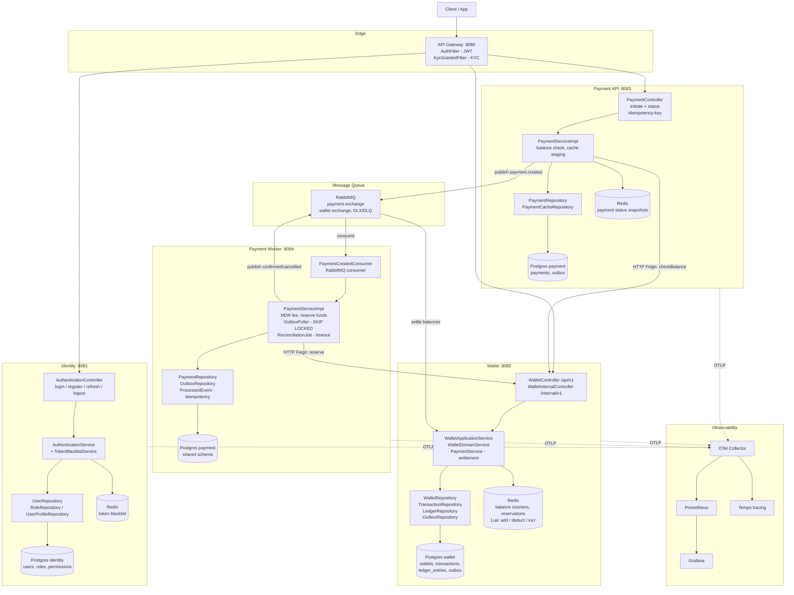
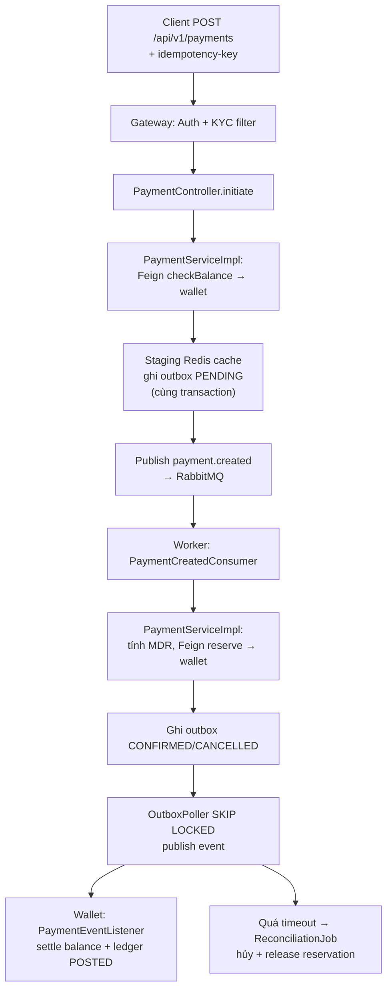

# Kiến trúc hệ thống Velet

> Tài liệu được trích xuất từ knowledge graph (`.ua/knowledge-graph.json` — 645 nodes, 1.201 edges, commit `e95edb03`).
> Velet là hạ tầng **payment & wallet** theo hướng consistency-heavy distributed system: Identity, Wallet, Payment core services,
> mở rộng theo mô hình super-app.

## 1. Tổng quan

- **Cổng vào duy nhất:** Spring Cloud Gateway (`services/gateway`, port 8080) — route + filter Auth/KYC.
- **Saga choreography** (Reserve → Confirm → Release), không có orchestrator trung tâm.
- **Transactional Outbox + RabbitMQ** để publish event async đáng tin cậy.
- **`SELECT FOR UPDATE SKIP LOCKED`** để worker đa instance claim job an toàn.
- **Ledger-as-source-of-truth**, Redis là read-through cache (Lua scripts đảm bảo atomic).
- Mỗi service sở hữu **Postgres + Redis riêng**; payment-api gọi wallet **đồng bộ qua HTTP (OpenFeign)**.
- Quan sát toàn hệ thống qua **OpenTelemetry Collector → Prometheus / Tempo / Grafana**.
- Mỗi service trùng lặp DTO/entity dùng chung theo module (không phụ thuộc Maven chéo module).

### Ports

| Service | Port | Entry point |
|---|---|---|
| gateway | 8080 | `GatewayApplication.java` |
| identity | 8081 | `IdentityApplication.java` |
| wallet | 8082 | `WalletApplication.java` |
| payment-api | 8083 | `PaymentApiApplication.java` |
| payment-worker | 8084 | `PaymentWorkerApplication.java` |

## 2. Sơ đồ tổng thể

## 3. Trách nhiệm từng thành phần

### 3.1 Gateway (`services/gateway`)

| Component | Trách nhiệm |
|---|---|
| `GatewayApplication` | Bootstrap, route tới identity / wallet / payment / loyalty (port 8080) |
| `AuthFilter` | Verify chữ ký + expiry của Bearer JWT (Nimbus MACVerifier), bỏ qua public paths |
| `KycGrantedFilter` | Ép header `X-Kyc-Status: VERIFIED` cho các path kyc/wallet/payment |
| `MutableHttpServletRequest` | Wrapper inject claim user đã xác thực vào request |
| `SecurityAppProperties` | Bind `jwtSecret`, `publicPaths` từ config |

### 3.2 Identity (`services/identity`)

| Component | Trách nhiệm |
|---|---|
| `AuthenticationController` | Endpoints `login / register / refresh-token / logout` (+ hello) |
| `AuthenticationServiceImpl` | Validate credential, đăng ký user, phát JWT access/refresh, logout |
| `TokenBlacklistServiceImpl` | Blacklist token bằng Redis (key hash SHA-256, TTL theo expiry) |
| `JwtUtil` | Sinh/parse JWT bằng Nimbus JOSE |
| `SecurityConfig` | Filter chain stateless, JWT decoder HS512 + blacklist validator |
| Repository (`User/Role/UserProfile`) | Truy vấn user, role mặc định, profile theo user-id |
| Entities (`User, UserProfile, Role, Permission, RolePermission, UserRole`) | RBAC + KYC status, audit qua `BaseEntity` (createdAt/updatedAt/soft-delete) |
| `V1__init_schema.sql` | Tạo bảng users, user_profiles, roles, permissions + bảng nối |
| `V1.1__seed_test_data.sql` | Seed permission/role, admin + 9 users test |

### 3.3 Wallet (`services/wallet`) — trung tâm tiền tệ

| Component | Trách nhiệm |
|---|---|
| `WalletController` (`/api/v1/wallets`) | transfer, xem balance, reserve, trạng thái reservation, release |
| `WalletInternalController` (`/internal/v1/wallets`) | `balance-check` cho gọi service-to-service (payment-api/worker) |
| `WalletApplicationService` | Facade: lock phân tán Redis + cập nhật cache quanh transaction DB |
| `WalletDomainService` | Ghi atomic transfer/reserve/confirm/release + ledger entries |
| `PaymentServiceImpl` (wallet) | Settlement: complete reservation rồi post bút toán MDR fee nội bộ |
| `WalletCacheSyncServiceImpl` | Đồng bộ delta (transfer/reservation/release) vào Redis cache, idempotent qua `ProcessedEvent` |
| `SystemAccountCache` | Preload ID ví hệ thống theo `AccountType` khi khởi động |
| `BalanceSnapshotWorker` | Snapshot balance hằng ngày lúc 3h sáng |
| Repository JPA | `WalletRepository` (pessimistic lock + native balance query), `Transaction/Ledger/BalanceSnapshot/Outbox/ProcessedEvent` |
| `WalletCacheRepositoryImpl` | Redis: counters, locks, reservation records (Lua: `wallet_add/deduct/increment_counter`) |
| `OutboxPoller` | Claim outbox PENDING → publish lên wallet exchange theo routing key |
| `PaymentEventListener` / `TransactionEventListener` | Nhận confirmed/cancelled từ payment exchange để settle; nhận transfer/reservation/cancel để sync cache |
| Entities | `Wallet` (owner/category/type/currency/status), `Transaction`, `BalanceReservation`, `LedgerEntry` (DEBIT/CREDIT × PENDING/POSTED), `BalanceSnapshot`, `Order/Bill` |
| Migration | `V1__init_schema.sql` (wallet/transaction/ledger/outbox), seed test + benchmark (100 ví × 50M VND) |

### 3.4 Payment API (`services/payment-api`) — mặt tiền khởi tạo thanh toán

| Component | Trách nhiệm |
|---|---|
| `PaymentController` | Khởi tạo payment + tra cứu status, xử lý `idempotency-key` |
| `PaymentServiceImpl` | Check balance qua wallet (Feign), staging cache, publish event với broker confirms |
| `WalletClient` / `WalletFeignClient` / `WalletRestClient` | Port `checkBalance()` — gọi GET balance-check của wallet, thiết kế swappable REST→gRPC |
| `PaymentRepository` | Truy vấn payment theo idempotency + timeout |
| `PaymentCacheRepositoryImpl` | Snapshot trạng thái payment trên Redis (hash + index phụ idempotency) |
| `Outbox` (`PENDING→PROCESSING→SENT/FAILED`) | Entity + enum `AggregateType/EventType/OutboxStatus` cho transactional outbox |
| `MdrCalculator` (worker) / pricing | Tính phí MDR + số tiền merchant thực nhận |
| `TraceContextCapture` | Truyền traceparent OpenTelemetry theo event |

### 3.5 Payment Worker (`services/payment-worker`) — xử lý async

| Component | Trách nhiệm |
|---|---|
| `PaymentCreatedConsumer` | Consume event từ queue: persist payment, ack/nack theo loại lỗi |
| `PaymentServiceImpl` | Tính MDR, reserve tiền ở wallet, ghi outbox events |
| `OutboxPoller` | Claim batch PENDING bằng `SKIP LOCKED`, publish lên payment exchange |
| `PaymentProcessingHandler` | Poll định kỳ, re-drive payment đang dở theo batch |
| `ReconciliationJob` | Hủy payment quá confirmation timeout |
| `MerchantClient` / `MerchantRestClient` | Lấy MDR rate (hiện mock 1.5%, giữ sẵn code Feign thật dạng comment) |
| `WalletClient` (reserve) | Gọi POST reserve của wallet qua Feign + mapping lỗi retryable/HTTP |
| `ProcessedEvent` + `ProcessingStatus` | Idempotency cho event đã consume |

### 3.6 Message Queue (RabbitMQ)

- **Payment exchange:** `payment.created` (api → worker), `payment.confirmed/cancelled` (worker → wallet), queue durable + DLX/DLQ, JSON converter có id-to-class mapping.
- **Wallet exchange:** cache-sync, reservation, transaction-cancel queues + bindings (khai báo trong `PaymentConsumerConfig`, `WalletExchangeConfig`, `RabbitMessageConverterConfig`).

### 3.7 Database (Postgres — mỗi service 1 DB)

- `init_db.sql` bootstrap 4 DB: identity, wallet, payment, loyalty.
- Identity: users/profiles/roles/permissions. Wallet: wallets/transactions/balance_reservations/ledger_entries/balance_snapshots/outbox/processed_event/orders/bills. Payment: payments/outbox (+ bảng phụ idempotency/cache snapshot trên Redis).

### 3.8 Observability & hạ tầng

- `AppConfig` (mỗi service): JPA auditing, scheduling, async, `ObjectMapper`/`RestTemplate`.
- `ObservationConfig`: `ObservedAspect` + `TaskDecorator` lan truyền trace context sang async task.
- Stack: OTel Collector (OTLP gRPC/HTTP) → Prometheus (scrape 30s) / Tempo (trace) → Grafana (`infrastructure/*`, `docker-compose.obs.yml`).
- Base stack: `docker-compose.yaml` (Postgres, Redis, RabbitMQ). Load test k6 (`scripts/k6/load-test.js` — ramp 2.500 VU vào `POST /api/v1/payments`). Script chạy local: `scripts/dev-up.(sh|bat)`.

## 4. Luồng thanh toán chính (saga)

Các đảm bảo: **idempotency** (idempotency-key + `processed_event`), **exactly-once effect** (outbox + consumer idempotent),
**an toàn đa instance** (`SKIP LOCKED`), **nhất quán số dư** (ledger là source-of-truth, Redis chỉ là cache atomic bằng Lua).
